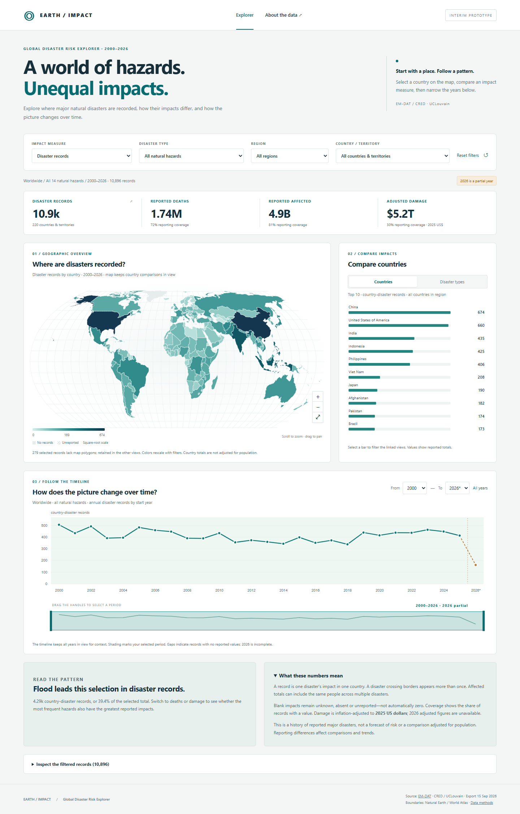

# Global Disaster Risk Explorer

An interactive D3.js dashboard for exploring the occurrence and reported impacts of natural disasters. Built for the data visualization class project by Tobias Garcia and Ha Nguyen.

## Run locally

From this folder:

```powershell
python -m http.server 8000 --bind 127.0.0.1
```

Open **http://127.0.0.1:8000**. Stop the server with Ctrl+C. A local HTTP server is needed to load the data; opening `index.html` directly will not work. No npm installation or build step is required, and all runtime libraries and data are bundled locally.

## Explore

- Explore disaster locations on a neutral world map; zoom, pan, or highlight a country. Switch to **Country impacts** for a separate choropleth without event markers.
- Toggle each disaster type independently: from All, a click excludes only that type. Use None to build a smaller subset. Hover or focus a type for a short explanation; [hazard colors and terminology](docs/hazard-encoding.md) documents the palette and sources.
- Switch between records, reported deaths, affected populations and adjusted damage.
- Combine any of 34 hazard categories using the **Disaster types** checkbox menu, including tsunami, avalanche, hurricane/typhoon, tornado, heatwave, blizzard, hailstorm and duststorm. Search, All and None make larger selections manageable.
- Compare country or hazard rankings in a fixed-height scroll area. Country bars highlight locally; disaster bars select a combination of hazards across the map and linked views. The full type ranking stays available for comparison while filtering.
- Drag the timeline brush handles or use year selectors to zoom the detail chart; switch between yearly and monthly resolution.
- Set the map’s From/To years, select **Animated timeline**, then **Play** to replay daily recorded starts. Pins and one-second expanding rings share each hazard’s color with the daily event timeline and type rankings. In Country impacts mode, replay shading shows records accumulated through the current date on a fixed scale.
- Playback advances one year in **4s (Fast)**, **12s (Normal)** or **24s (Slow)**. Animated markers fade after **2.5 seconds** while the full timeline and cumulative record history stay available. Selecting a hazard or entering animation reveals a matching recorded date. Optional **Skip quiet gaps** compresses empty time; **Next recorded start** jumps to the next reported day. Explicit map years and local filters stay in force.
- Timelines retain dated records when country references are hidden. A visible **Show country references** action explains and restores map placement for hazards without coordinates. Incomplete dates remain available in Selected period and are never assigned an invented replay day.
- Scrub the daily timeline, step by day, or jump to a year. Filled pins use source coordinates; optional hollow pins use approximate country reference points. Open **Disaster colors** for the key and counts.
- Use **Expand map** above the zoom controls to fill the viewport and move Compare Impacts below it; press Escape to restore the layout.
- **Group overlaps** combines nearby source coordinates into numbered groups that refine with zoom. Country reference records group separately by country. Click a group to inspect its records and optionally zoom in.
- **Marker size** compares individual records by reported deaths, affected people, or adjusted damage on a fixed area scale. Ungroup to see all individual symbols; diamonds mark reported zero and crosses mark unreported values.
- Open **Explore this selection** for a linked time brush, date inputs, local country selection, impact summaries, type composition, a searchable paginated record list, and persistent event details. **Select area** draws a rectangle using source coordinates; **Enter area bounds** provides keyboard inputs. These filters are local to Geographic Overview, and playback respects the selected interval.
- Event details list other country records sharing the source event identifier and highlight currently visible matches, including access to records outside the current selection.
- Explore seasonal record averages, disaster-type composition, and a treemap with local World → Region → Country navigation, breadcrumbs and Back.
- Compare country disaster profiles in the coordinated **Country–Hazard Relationships** section. Independent searchable multi-selects control countries and disaster types; choose the reproducible contrast default, top-by-frequency, all, or any manual combination. Every selected type appears in both views, including zero-count relationships.
- The network shows all positive-count relationships by default. Optional Top 2 and Top 3 filters are explicit user choices and report how many valid relationships they omit from the network; the scrollable matrix always retains the complete selection. Hover and selections are linked across both views; select up to two countries for an exact-count profile comparison.
- Open **Poster view / Export figure** to create a control-free combined figure from the current data context. Large selections require explicitly choosing the legible 6-country × 8-type contrast preset; the explorer selection is never silently truncated. SVG and 2× PNG dimensions adapt to the selected content.
- Open [About the Data](about.html) for verified dataset statistics, real chart previews, interaction plans and the proposed usability study.
- Inspect reporting coverage, individual records, and download the filtered CSV.

The default scope is **2000–2026, all natural hazards**. **2026 is partial.** Adjusted damage uses **2025 USD**. Unknown impacts remain null; recorded totals are not estimates of future risk.



## Data and reproduction

The original EM-DAT export supplied by the project owner is preserved in `data/raw/`. It has 10,896 country-disaster records, 9,001 distinct event identifiers, 220 countries/territories, and 14 broad source hazard types. The interface exposes 34 categories using recorded subtypes; original classifications remain in the processed data and filtered downloads. Sinkhole and firestorm have no explicitly classified records in this export and are shown as unavailable.

Only 1,864 records have source coordinate pairs. Daily replay includes only complete valid start dates on or before the 15 September 2026 export cutoff (9,331 records); other records remain in period totals. Pulses represent recorded starts, not hazard extent or propagation. Reduced-motion preferences suppress the expanding rings.

```powershell
python -m pip install -r requirements.txt
python scripts/prepare_data.py data/raw/public_emdat_custom_request_2026-09-15_8a971085-98e9-420a-9513-c44f4dc5eca4.xlsx --start-year 2000 --end-year 2026 --all-natural
```

Outputs include cleaned CSV/JSON, a source checksum and quality report, aggregates by country/type/year, impact distributions, largest-impact records and a generated analysis report. See [data methods](docs/data-methods.md) for the field dictionary and cleaning rules.

## Interim deliverables

- [Interim checklist, findings and presentation walkthrough](docs/interim-status.md)
- [Finalized research questions](docs/research-questions.md)
- [Initial analysis](docs/initial-analysis.md)
- [Interface rationale and coordination rules](docs/interface-design.md)
- [Desktop/mobile wireframe](docs/interface-wireframe.svg)
- [Mobile prototype screenshot](docs/prototype-mobile.png)
- [Original project proposal](proposal.md)
- [Project rubric](project-rubric.md)

The dashboard now includes the original six analytical views plus the coordinated country–hazard network and matrix. See [country–hazard methods and interactions](docs/country-hazard-explorer.md), [implementation and verification](docs/enhancement-verification.md), and [monthly data methods](docs/data-methods.md).

## Verify

```powershell
python -m unittest discover -s tests -p test_data.py
node --test tests/data.test.js tests/hazards.test.js tests/map-analysis.test.js
```

For browser integration checks, leave the local server running, install Playwright if needed (`python -m pip install -r tests/requirements.txt`), then run:

```powershell
python tests/event_map_check.py
python tests/map_controls_check.py
python tests/map_exploration_check.py
python tests/sparse_replay_check.py
python tests/playback_performance_check.py
python tests/country_hazard_check.py
```

These browser checks detect installed Chrome on macOS/Windows, or use Playwright Chromium on Linux. Set `CHROME_PATH` to override it. They verify source counts, replay and pulse behavior, map encodings, multi-hazard selection, ranking bounds, scroll preservation, keyboard/search interactions, coordinated network/matrix behavior, poster rendering, expanded layouts and mobile controls. The older `browser_check.py` and `ux_check.py` scripts retain the interim interface contracts.

## Sources

Disaster data: [EM-DAT, CRED / UCLouvain](https://public.emdat.be/), export dated 15 September 2026. Definitions: [EM-DAT documentation](https://doc.emdat.be/docs/). Geography: Natural Earth via [World Atlas 2.0.2](https://github.com/topojson/world-atlas). Local libraries and licenses: [vendor notes](vendor/README.md).

See [event-map behavior](docs/event-map.md) and [map exploration](docs/map-exploration.md) for the current controls and semantics. The [Geographic Overview review](docs/geographic-overview-review.md) records their design rationale and the remaining optional comparison feature. The [UX update](docs/ux-update.md) records the earlier independent-clock and treemap work.
