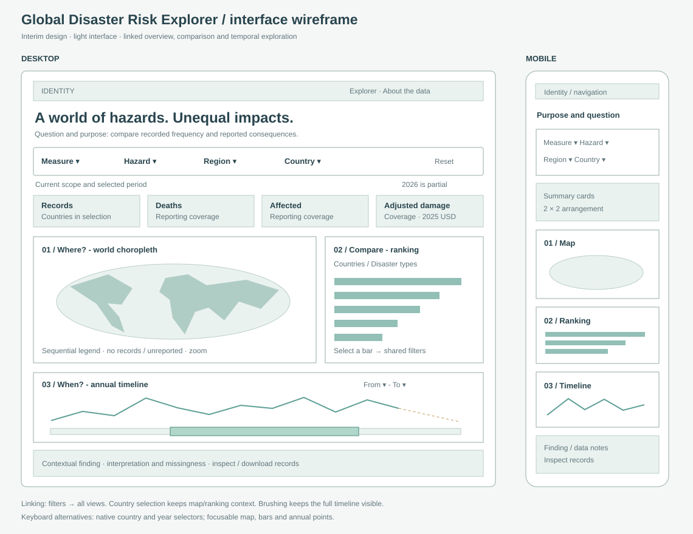

# Interface sketches and design rationale

## Wireframe

The project owner approved a light interface with teal-to-dark-blue map colors and three linked views: geographic overview, timeline and ranking. The wireframe records the layout and interaction hierarchy used for the interim prototype.

## Working mockups

- [Desktop prototype screenshot](prototype-desktop.png)
- [Mobile prototype screenshot](prototype-mobile.png)

These are screenshots of the implemented interface with the actual processed export. They are not simulated data.

## What / why / how

| View | What | Why | Marks and channels | Interaction |
|---|---|---|---|---|
| World choropleth | Country totals for selected hazard, period, region and metric | Locate concentrations and select a country | Equal Earth projection; polygon fill using sequential color and square-root scale | Country selection, hover/focus details, zoom/pan |
| Ranking | Top ten countries or hazard types | Compare totals precisely and find changes in ordering | Horizontal bars; linear length from zero; labels | Switch grouping, select a bar to filter other views |
| Timeline | Annual record counts or reported impact totals | Inspect peaks and compare periods | Linear x/y axes, straight line segments, points; dashed amber segment for partial 2026 | Year brushing, keyboard-accessible year selectors, annual details |

## Coordination rules

Shared state contains the metric, hazard type, region, selected country and inclusive year bounds. Every change updates the relevant views, summary cards, contextual finding and inspectable records.

- **Map:** filters hazard, region and years; keeps other countries visible when one is selected. The selected country receives an amber outline.
- **Country ranking:** filters hazard, region and years; retains comparison countries while a country is selected.
- **Hazard ranking:** filters country, region and years; keeps other hazard types visible while one is selected.
- **Timeline:** filters country, hazard and region; keeps the full temporal context while shading the selected period.
- **Summary cards, finding and table:** apply every filter.
- **Region change:** clears country selection and repopulates the country selector with countries in that region.
- **Reset:** restores all natural hazards, countries and years, record count, country ranking and initial map zoom.

This is intentional contextual filtering. Each view describes its scope in a subtitle so the viewer can distinguish a focused total from a comparison set.

## Encoding and accessibility decisions

- Gray polygons mean no matching records. Hatched polygons mean records exist but all selected impacts are unreported. Neither encodes zero hazard risk.
- The map scale resizes to the filtered maximum and labels its square-root transformation. The ranking and timeline retain linear axes.
- Large numeric totals use k/M/B/T abbreviations; hover or focus provides full values. Adjusted dollars are labeled 2025 USD.
- Filter controls are native labeled selects. Map polygons and ranking bars support Enter/Space; the country selector includes small and historical territories.
- Year selectors provide a keyboard alternative to brushing. Timeline points expose annual values on focus. Focus outlines are visible, and a skip link is provided.
- The layout stacks map, ranking and timeline on mobile. Timeline geometry and tick density adapt to the available width.
- The prototype bundles libraries and map/data assets locally and makes no external requests during use.

## Relation to the proposal's references

The supplied examples emphasize geographic exploration, multivariate layers and categorical risk matrices. This prototype adopts the geographic overview and coordinated control concept, while using a single selected measure to keep the map legible for a general audience. It does not reproduce a categorical risk rating: EM-DAT alone does not supply the exposure and likelihood inputs needed to calculate that rating.

## Remaining final-project work

The interim implements three visualization idioms. The rubric's final requirement is five. The proportional-symbol map and relationship scatterplot remain planned; their implementation should add a meaningful comparison or relationship task. A final report, poster, presentation and publication also remain later deliverables. No publication is part of this session.
